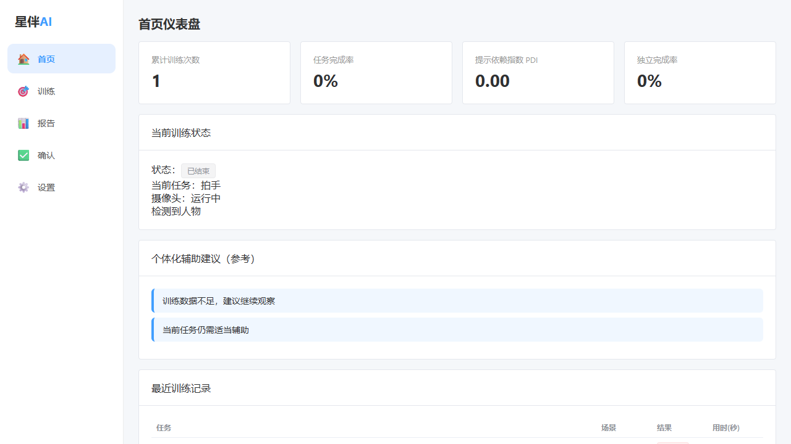
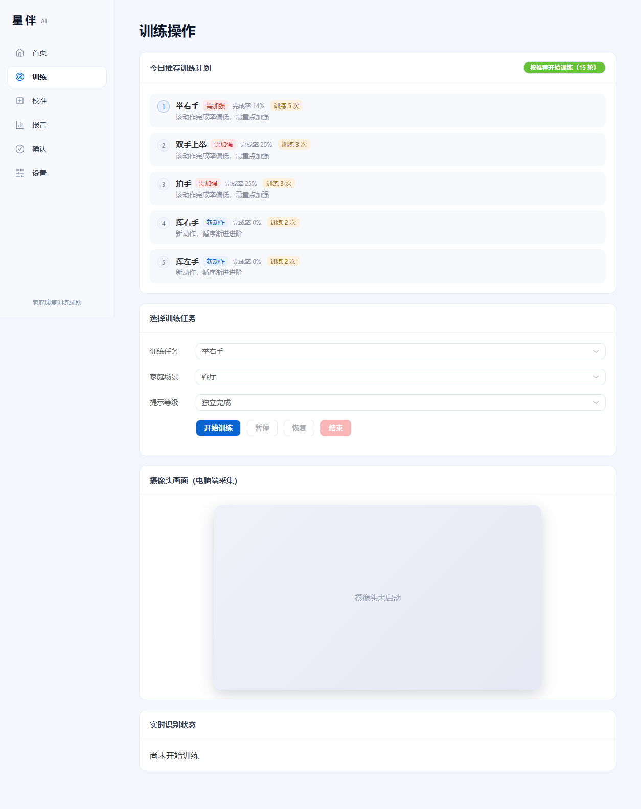
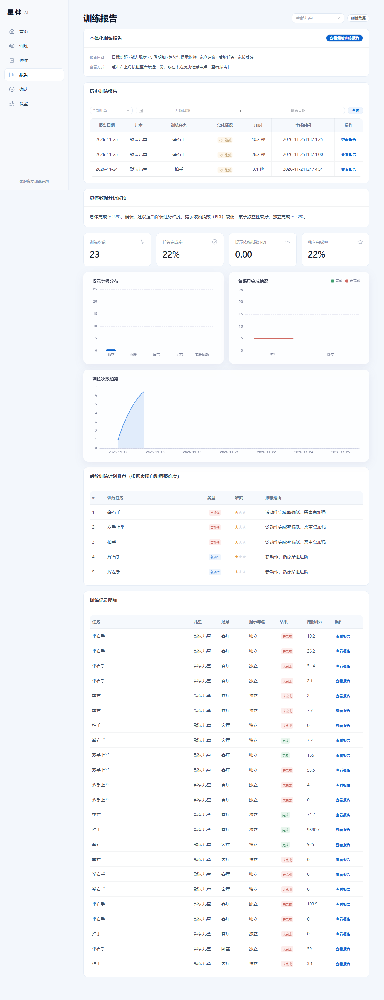

# 星伴AI —— 基于计算机视觉与个体化行为分析的孤独症儿童家庭康复训练辅助系统

面向孤独症儿童家庭康复训练场景，使用普通摄像头识别儿童动作、姿态及人与物品的交互行为，
辅助家庭康复训练过程中的**行为记录、提示依赖分析、训练数据管理与个体化辅助决策**。

> ⚠️ **免责声明**：本系统不是医疗诊断软件，不替代专业康复人员，也不能直接判断康复效果。
> AI 识别结果仅供辅助参考，提示等级调整等建议须经专业康复人员审核。

## 功能特性

- **人体姿态识别**：MediaPipe Pose 33 关键点，含平滑滤波与出画锁定
- **动作识别**：举手、拍手，以及 100 个动作的声明式规则引擎（`action_engine.py`）
- **多步骤任务理解（核心）**：YOLO 物品检测 + 人-物交互识别 + 连续行为 FSM，
  实现「寻找→接近→拿起→移动→放入收纳盒」端到端任务
- **个性化训练方案**：根据儿童历史完成情况自动生成「需加强 → 巩固 → 新动作」
  训练计划，练得越差的动作越优先安排（`core/plan.py` + `GET /api/plan`）
- **方案模式连续训练**：一次开始按计划顺序连续练多个动作，练完一个自动进入
  下一个，每个动作独立记录完成情况（`POST /api/training/start_plan`）
- **实时语音播报**：训练指令、步骤完成、任务完成全程语音提示，
  基于 Windows TTS（`services/tts.py`）
- **儿童桌面训练端**：打开自动加载今日计划（免手动选任务）、摄像头画面、
  方案进度实时高亮、结束弹出完成数/用时/PDI/独立完成率
- **网页系统**：训练控制（开始/暂停/恢复/结束）、报告统计、人工确认、档案管理
- **个体化辅助决策**：提示依赖指数（PDI）、独立完成率、可解释规则建议
- **规范数据库 11 张表**：AI 识别结果与人工确认分开存储，可追溯
- **多设备访问**：电脑运行算法与摄像头，手机/平板通过局域网浏览器操作

## 系统截图

### 首页仪表盘

训练统计、当前训练状态与个体化辅助建议：



### 训练操作页

选择任务 / 场景 / 提示等级，开始、暂停、恢复、结束训练，实时显示摄像头画面与识别状态：



### 训练报告页

训练次数、完成率、PDI、独立完成率，以及提示等级分布、场景表现、趋势图表（ECharts）：



### 人工确认页

AI 识别结果与人工确认分开存储，可对不确定的识别结果进行人工确认：


> 注：截图为 1 次测试训练后的初始状态，非真实儿童训练数据。

## 技术栈

| 层 | 技术 |
|---|---|
| 后端 | FastAPI + Uvicorn + SQLAlchemy + SQLite + Pydantic |
| 前端 | Vue3 + Element Plus + ECharts + Axios |
| 视觉 | OpenCV + MediaPipe Pose + Ultralytics YOLO + NumPy |
| 算法 | 规则式交互识别 + FSM 有限状态机 + DTW 相似度 |
| 语音 | pyttsx3（Windows SAPI5，训练指令实时播报） |
| 硬件/桌面端 | ESP32 串口控制器（需实物联调）、PySide6 儿童训练端（对接后端） |

## 目录结构

```text
├── vision/                 计算机视觉算法（姿态/动作/交互/行为FSM/物品检测）
│   └── 自训练流水线：collect_dataset → label_dataset → train_custom_yolo → evaluate_model
├── services/               业务服务层（摄像头/训练调度/方案模式/报告/语音TTS/视觉事件）
├── api/                    接口路由（训练/方案训练/摄像头/报告）
├── database/               SQLAlchemy 模型 + CRUD + 种子数据（11 张表）
├── server/                 FastAPI 入口（main.py / run.py）
├── frontend/               Vue3 前端工程
├── core/                   decision.py（PDI 辅助决策）+ plan.py（个性化方案推荐）
├── hardware/               ESP32 交互盒串口控制器 + 固件（需实物联调）
├── desktop/                PySide6 儿童训练端（推荐计划/连续训练/语音/摄像头画面）
├── tests/                  单元测试
├── data/                   任务库（tasks.json/actions.json）
└── docs/                   项目文档
```

## 快速开始

### 1. 环境要求

- Windows，Python 3.12（MediaPipe Windows 包仅支持到 3.12）
- 全程 CPU 运行，无需 NVIDIA GPU

### 2. 安装依赖

```powershell
# 创建并激活虚拟环境（示例）
python -m venv .venv
.\.venv\Scripts\Activate.ps1

# 安装依赖
pip install -r requirements.txt
```

### 3. 模型文件说明

- `vision/models/pose_landmarker_full.task`：已随仓库提供（MediaPipe 姿态模型，约 9MB）
- `vision/models/yolo11n.pt`：**首次运行会自动下载**（约 5MB），无需手动处理

### 4. 启动网页系统

```powershell
# 方式一：双击「启动训练系统.bat」
# 方式二：命令行
python -m server.run
```

启动成功后（约 6~12 秒），浏览器打开 `http://127.0.0.1:8000`。

手机/平板（同一 Wi-Fi）打开 `http://电脑局域网IP:8000`（`ipconfig` 查看 IPv4 地址）。

> 前端已构建（`frontend/dist/` 随仓库提供），**无需安装 Node.js 即可直接使用**。
> 只有当你修改了前端代码（`frontend/src/`）时，才需要进入 `frontend/` 目录执行
> `npm install && npm run build` 重新构建。

### 4.5 启动桌面训练端

```powershell
# 先启动后端（python -m server.run），再另开一个窗口运行桌面端
python desktop/main_window.py
```

桌面端为儿童训练专用界面（宋体、大按钮）：
- 打开自动加载「今日训练计划」（按历史完成情况个性化推荐，免手动选任务）；
- 一键「开始训练」按计划连续练多个动作，练完一个自动进入下一个；
- 每个动作有语音指令播报，画面实时显示摄像头与进度（`[√]`完成 `[>]`当前）；
- 结束弹出本次完成动作数、用时、累计 PDI 与独立完成率；
- 若上次训练未正常结束，打开时会自动检测，点「结束」即可清掉后重练。

### 5. 直接运行视觉脚本

```powershell
python vision/task_session.py                              # 举手/拍手训练任务
python vision/action_library.py                            # 动作库实时演示
python vision/skill_task_session.py --target bottle        # 多步骤生活技能任务
```

### 6. 自定义物品自训练（解决「收纳盒」识别）

YOLO 使用 COCO 预训练模型，**无法识别「收纳盒」**这类自定义物品。
本项目提供完整自训练流水线：**采集 → 标注 → 训练 → 评估**。

```powershell
# ① 采集图片（空格拍一张 / s 连拍 / q 退出）
python vision/collect_dataset.py --class box

# ② 画框标注（拖拽画框 / n 保存下一张 / s 跳过 / q 退出）
python vision/label_dataset.py --class box

# ③ 微调训练（基于 yolo11n.pt，CPU 可跑）
python vision/train_custom_yolo.py --name box --epochs 60

# ④ 评估精度（Precision / Recall / F1）
python vision/evaluate_model.py --model vision/models/custom_box.pt
```

- 采集数量建议：单类 150~300 张，覆盖多角度/多距离/多光照；
- 训练完成后，把 `skill_task_session.py` 的 `--target` 换成你的自定义类名即可；
- 权重自动导出到 `vision/models/custom_<name>.pt`。

### 7. ESP32 交互盒固件

`hardware/esp32_controller.py` 为电脑端串口控制器（需 `pip install pyserial`），
配套固件在 `hardware/esp32_firmware/esp32_firmware.ino`（Arduino IDE 烧录）。
串口协议：`LED:ON/OFF`、`BUZZ:毫秒`，按键上报 `BTN:1/0`。

### 8. 运行单元测试

```powershell
python tests/test_behavior_fsm.py
python tests/test_dtw.py
python tests/test_decision.py
python tests/test_action_engine.py
```

## 数据库设计（11 张表）

`child_profile`（儿童档案）/ `task_definition`（任务定义）/ `task_step`（任务步骤）/
`scene_info`（场景）/ `training_session`（训练记录）/ `step_event`（步骤事件）/
`prompt_record`（提示等级）/ `vision_result`（AI 识别原始结果）/ `manual_review`（人工确认）/
`analysis_result`（分析结果）/ `model_version`（模型版本）

核心原则：**AI 识别结果与人工确认分开存储**，人工修正只新增、不覆盖原始模型结果。

## 提示等级标准

| 等级 | 含义 |
|---|---|
| 0 | 独立完成 |
| 1 | 视觉提示 |
| 2 | 语音提示 |
| 3 | 动作示范 |
| 4 | 家长协助 |

PDI（提示依赖指数）= Σpᵢ / (4N)，独立完成率 = 独立完成任务次数 / 有效任务次数 × 100%。

## 关键技术结论（调试实证）

1. **识别用原始帧，显示用镜像帧**：镜像画面喂给模型会导致左右手判定颠倒
2. **快慢动作分策略**：持续动作（举手）用重平滑+长防抖；瞬时动作（拍手）用原始关键点+短确认
3. **迟滞门槛防临界抖动**：进入/退出状态用两道不同门槛
4. **阈值参数必须实测标定**：印证「个体化行为分析」方向，正式产品应支持按个体自动标定阈值
5. **已知局限**（单目 2D 方案固有边界）：手臂完全出画无法识别、宽松衣物影响精度、
   精度为行为记录级而非医学测量级；YOLO 用 COCO 预训练模型，**无法识别收纳盒**，
   需用碗/书/杯等可识别物品替代（已如实标注，未虚构能力）

## 开发环境

- 操作系统：Windows 笔记本，Intel Arc 140V 集成显卡（CPU 方案）
- Python 3.12.13（虚拟环境），pip 26.x
- 依赖版本见 `requirements.txt`

## 常见问题 FAQ

**Q1：摄像头打不开 / 画面不出来？**
- 确认后端已启动（黑色窗口显示 `Uvicorn running on http://0.0.0.0:8000`）；
- 确认摄像头未被其他程序（微信、腾讯会议等）占用；
- 检查 Windows「设置 → 隐私 → 相机」是否允许桌面应用访问摄像头。

**Q2：报错 `Unable to open file at ...pose_landmarker_full.task`？**
- MediaPipe 底层无法打开**含中文的绝对路径**。本项目已改为相对路径规避；
- 若仍遇到，请勿将项目放在含中文的目录下。

**Q3：yolo11n.pt 下载慢或失败？**
- 首次运行由 ultralytics 自动下载（约 5MB）；
- 可手动从 Ultralytics 官网下载后放入 `vision/models/`。

**Q4：后端启动慢（6~12 秒无反应）？**
- 首次启动需建库 + 导入任务库种子数据，属正常，请耐心等待。

**Q5：手机/平板连不上？**
- 确认与电脑连接**同一 Wi-Fi**；
- 使用电脑局域网 IPv4 地址（`ipconfig` 查询），而非 `localhost`；
- 首次访问时在 Windows 防火墙中放行 8000 端口。

## 更新日志

- **v2.0**（2026-11）：网页系统改造——FastAPI 后端 + SQLite 规范数据库（11 表）+
  Vue3 前端 + 多步骤任务理解（把物品放入收纳盒）+ 统一视觉事件格式 + 硬件/桌面端框架
- **v1.0**：视觉算法阶段——姿态识别、举手/拍手、人-物交互识别、行为 FSM、动作库

## License

[MIT](./LICENSE)
